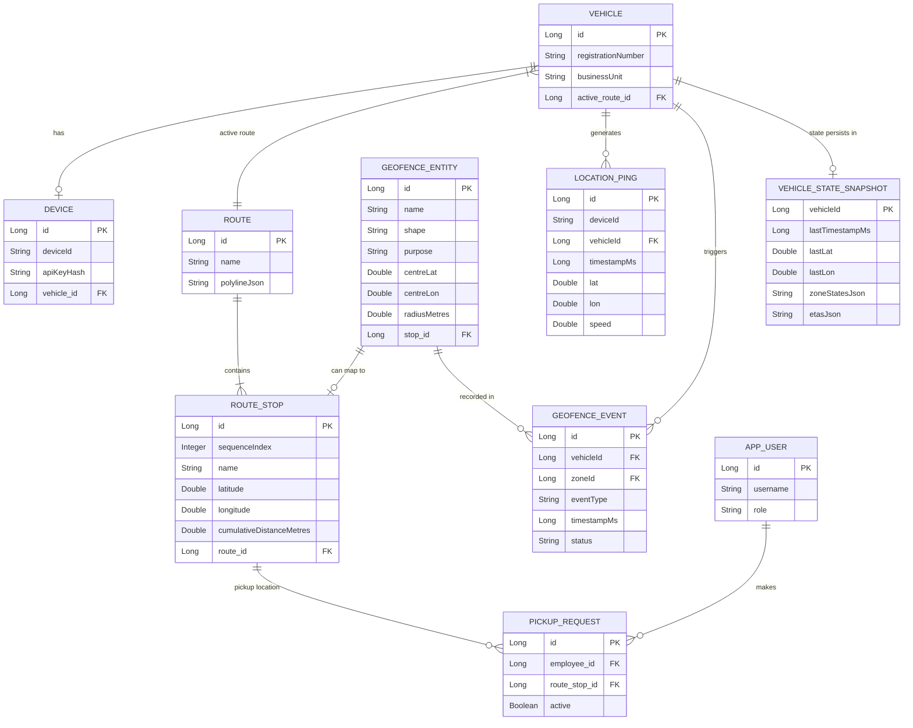

# Vehicle Tracking Service

A high-performance, real-time vehicle tracking backend service built with Spring Boot and Java 21. This service ingests high-frequency location pings from devices, evaluates geofence transitions, computes route ETAs, and persists historical data asynchronously.

## Architecture & Design Decisions

### Entity-Relationship Diagram


### In-Memory State & Fast Ingestion
To handle high-throughput location updates without overloading the database, the service maintains live state in memory (`VehicleStateStore`).
- **Ping Pipeline:** Pings are ingested, deduplicated, and validated in memory.
- **Async History:** Accepted pings are enqueued into a bounded `ArrayBlockingQueue` and flushed to the database asynchronously in batches by a dedicated `HistoryWriter` thread. If the queue is full, pings are dropped to preserve system stability (tracked via Micrometer metrics).
- **State Recovery:** Cross-restart recovery is handled by `StatePersistenceService`, which persists regular snapshots of the `VehicleState` to the database and reloads them on startup.

### Concurrency Model
- **Striped Locking:** To prevent race conditions when a single device sends concurrent out-of-order pings, the ingestion pipeline employs a fixed array of `ReentrantLock`s keyed by `vehicleId % N`. This ensures thread safety for state mutations while allowing independent vehicles to be processed concurrently without global locking.

### Spatial Indexing & Geofencing
- **Grid Index:** Geofence zones are indexed in memory using a spatial grid (`GridIndex`). This reduces the `O(N)` point-in-polygon checks to an `O(1)` candidate lookup for each ping.
- **Hysteresis:** To prevent "flapping" (repeated entry/exit events due to GPS jitter), the geofence engine implements hysteresis. An entry requires crossing the exact boundary, while an exit requires moving beyond a configurable margin (e.g., 5% of radius or 10m).

### Route ETA Engine
- **Snap-to-Route:** The service matches live coordinates to the vehicle's pre-defined polyline route using Haversine distance, advancing the vehicle along the segments.
- **Speed EMA:** Speeds are smoothed using an Exponential Moving Average (EMA) to prevent erratic ETA fluctuations.
- **Event-Driven:** ETAs are published (simulated) only when significant changes occur to save bandwidth and downstream processing.

### Security & Observability
- **Authentication:** Devices authenticate via custom HTTP headers (`X-Device-ID`, `X-API-Key`) validated against a SHA-256 hash stored in the DB. The validation uses a Caffeine cache to avoid latency. User API endpoints are secured with stateless JWT tokens.
- **Outbox Pattern:** Geofence events are initially saved to the database in a `PENDING` state. A scheduled `OutboxPublisherService` sweeps these records and safely publishes them to an external message broker (simulated via logs), marking them as `SENT`.
- **Micrometer Metrics:** Key bottlenecks and queues (e.g., `HistoryWriter` queue size, `processUnderLock` transaction duration) are instrumented with Micrometer Gauges and Timers.

## Getting Started

### Prerequisites
- Java 21
- Maven

### Running the Application

By default, the application runs with an in-memory H2 database (with seed data loaded automatically) and the `test` profile.

```bash
./mvnw spring-boot:run
```

Seed data loaded on startup includes:
- 1 Vehicle (`KA-01-AB-1234`)
- 1 Device (`DEV-001`, API Key: `test-api-key-001`)
- 1 Route with 4 Stops (Electronic City to MG Road)
- 3 Geofences (Koramangala Pickup, MG Road Gate, Restricted Night Zone)

### Running the Simulator

A built-in simulator integration test drives a virtual vehicle along the seeded polyline, firing HTTP pings at intervals. It validates that the geofence entry/exit events and ETAs are generated correctly.

Ensure the application is stopped before running tests, or simply run the test via Maven:

```bash
./mvnw test -Dtest=SimulatorTest
```

### Running All Unit Tests

```bash
./mvnw test
```
