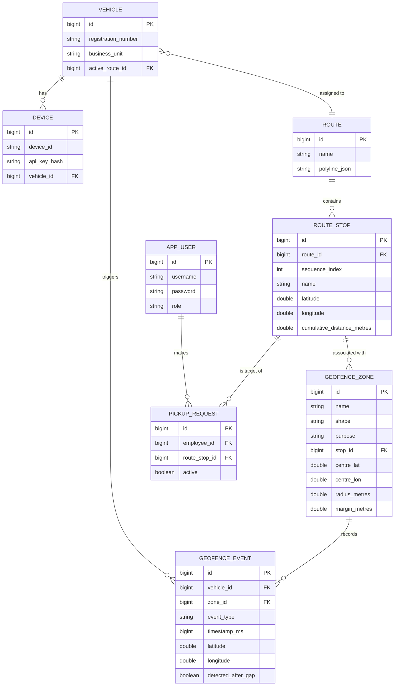

# Vehicle Tracking Service

This is a Spring Boot application providing an end-to-end vehicle tracking and geofencing service. It processes high-throughput GPS location pings from devices, executes geofencing rules for pickups, calculates route ETAs, and persists state.

## Core Features
- **High-throughput Ingestion**: GPS ping processing with future/stale validation, duplicate removal, and strict monotonicity enforcement using striped locking.
- **Geofence Engine**: Evaluates spatial constraints based on Haversine distance and geometric shapes. Detects Zone `ENTRY` and `EXIT` events, with gap compensation handling signal loss.
- **ETA Service**: Calculates ETA along polyline geometries and snaps pings to route sequences with caching.
- **REST APIs**: Provides secured API endpoints for Devices, Routes, Pickups, Geofences, and role-based administration.
- **Simulation**: Included simulator generates traffic scenarios, gaps, and tests concurrency rules.

## ER Diagram



## Running the Application
Ensure Postgres is running or run in H2 mode for tests.
Run the application via:
```bash
./mvnw spring-boot:run
```
For tests:
```bash
./mvnw test
```
