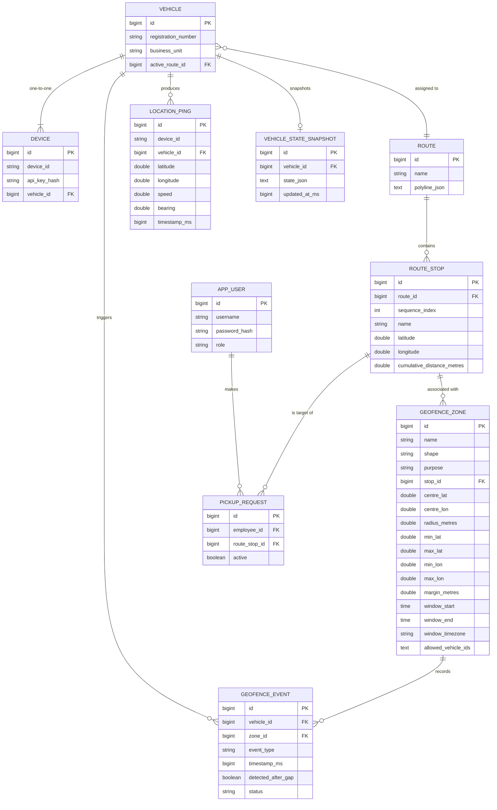

# Vehicle Tracking Service

A Spring Boot 4.x micro-service that processes high-throughput GPS pings, evaluates geofence rules, computes route ETAs, and exposes a secured REST API. Built with PostgreSQL, Caffeine caching, Micrometer metrics, and stateless JWT auth.

## Quick Start (Docker)

```bash
export DB_PASSWORD=yourpassword
docker compose up --build
```

| Service | Address |
|---------|---------|
| App (REST API) | http://localhost:8081 |
| PostgreSQL | localhost:5433 |

> Tests run automatically against an in-memory H2 database via `application-test.properties` — no Postgres needed for `./mvnw test`.

## Core Features

- **High-throughput Ingestion** — Future/stale validation, dedup cache, strict monotonicity, striped locking for per-vehicle concurrency.
- **Geofence Engine** — Circle + Rectangle shapes, hysteresis margins, time-windowed access rules, vehicle-level filters, gap detection.
- **Spatial Grid Index** — O(1) candidate lookup using a pre-built spatial grid; rebuilt on every geofence reload.
- **ETA Service** — Projects vehicle position onto a polyline, computes per-stop ETA with EMA speed smoothing and a publish-threshold to suppress jitter.
- **State Recovery** — Snapshots persisted to `vehicle_state_snapshots`; replayed on restart.
- **Outbox pattern** — Geofence events written with `PENDING` status; a scheduled publisher marks them `SENT`.
- **Security** — JWT for human users (ADMIN / APPROVER / EMPLOYEE), SHA-256 device API key for devices.
- **Observability** — Micrometer counters for accepted/rejected/dropped pings; `/actuator/health,metrics,prometheus`.

## ER Diagram



## API Quick Reference

All endpoints (except `/api/auth/login`, `/api/pings`, and `/actuator/health`) require `Authorization: Bearer <token>`.

| Method | Path | Auth | Description |
|--------|------|------|-------------|
| `POST` | `/api/auth/login` | — | Returns JWT token |
| `POST` | `/api/pings` | Device API Key (`X-Api-Key`) | Ingest GPS ping |
| `GET` | `/api/vehicles/{id}/position` | ADMIN, APPROVER | Last known position |
| `GET` | `/api/vehicles/{id}/events` | ADMIN, APPROVER | Geofence events |
| `GET` | `/api/pickups/me/eta` | EMPLOYEE | Employee's ETA to pickup stop |
| `GET` | `/api/routes` | ADMIN | List all routes |
| `POST` | `/api/routes` | ADMIN | Create route (computes stop cumulative distances) |
| `GET` | `/api/geofences` | ADMIN | List all geofence zones |
| `POST` | `/api/geofences` | ADMIN | Create geofence zone |
| `GET` | `/api/devices` | ADMIN | List devices (no key hash exposed) |
| `POST` | `/api/devices` | ADMIN | Register device (hashes API key server-side) |
| `GET` | `/actuator/health` | — | Health check |
| `GET` | `/actuator/metrics` | ADMIN | Metrics |
| `GET` | `/actuator/prometheus` | ADMIN | Prometheus scrape |

## curl Walkthrough

```bash
# 1. Login as admin
TOKEN=$(curl -s -X POST http://localhost:8081/api/auth/login \
  -H "Content-Type: application/json" \
  -d '{"username":"admin","password":"admin123"}' | jq -r .token)

# 2. Send a GPS ping using the seeded device key
curl -X POST http://localhost:8081/api/pings \
  -H "X-Api-Key: test-api-key-001" \
  -H "Content-Type: application/json" \
  -d '{"deviceId":"DEV-001","lat":12.935,"lon":77.610,"speed":10.0,"bearing":90.0,"ts":'$(date +%s000)'}'

# 3. Get vehicle position
curl -H "Authorization: Bearer $TOKEN" http://localhost:8081/api/vehicles/1/position

# 4. Get geofence events
curl -H "Authorization: Bearer $TOKEN" http://localhost:8081/api/vehicles/1/events

# 5. Employee ETA (login as employee1 first)
EMP_TOKEN=$(curl -s -X POST http://localhost:8081/api/auth/login \
  -H "Content-Type: application/json" \
  -d '{"username":"employee1","password":"emp123"}' | jq -r .token)
curl -H "Authorization: Bearer $EMP_TOKEN" http://localhost:8081/api/pickups/me/eta

# 6. List routes
curl -H "Authorization: Bearer $TOKEN" http://localhost:8081/api/routes
```

## Seeded Test Data

| Entity | Value |
|--------|-------|
| Vehicle | `KA-01-AB-1234`, route `Route-EC-MG` |
| Device | `DEV-001`, API key `test-api-key-001` |
| Admin user | `admin` / `admin123` |
| Approver user | `approver` / `approver123` |
| Employee user | `employee1` / `emp123` |

## Running Tests

```bash
./mvnw test
```

Tests use H2 in-memory via `src/test/resources/application-test.properties`. No Postgres needed.

## Building & Running Locally

```bash
export DB_PASSWORD=yourpassword
./mvnw spring-boot:run
```
