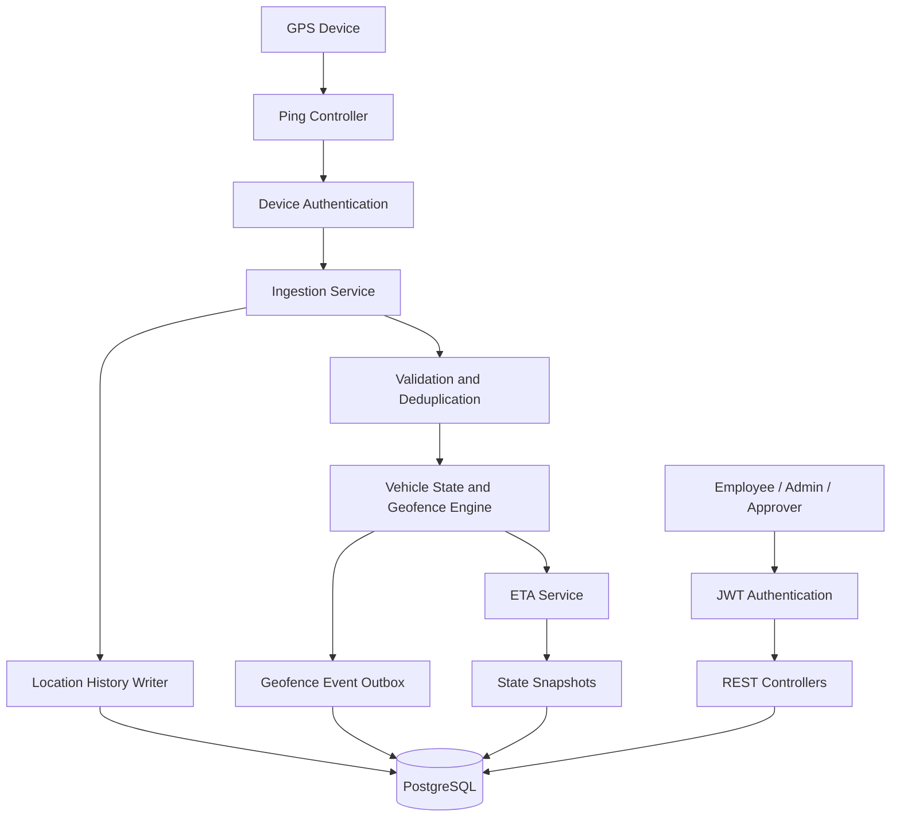
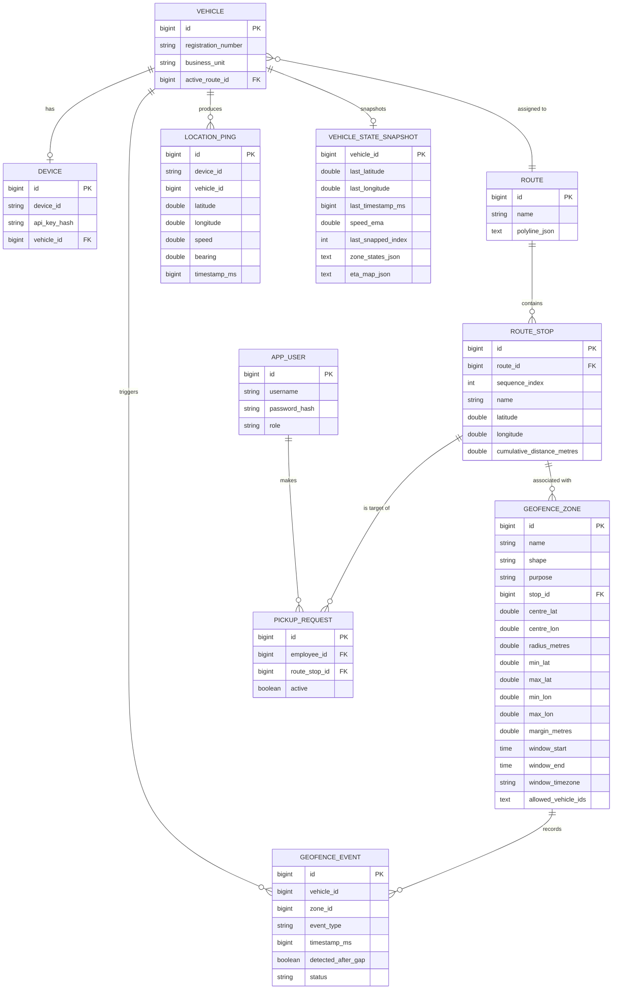

# Vehicle Tracking Service
### MoveInSync Backend Case Study 2 — Live Vehicle Tracking, Geofence Events & ETA
A Java/Spring Boot backend service that processes GPS location updates, tracks vehicle positions, detects geofence entry and exit events, and calculates estimated arrival times (ETAs) for employee pickups.
Built as a solution to the **MoveInSync SDE — Java Backend Hiring Assessment, Case Study 2**.
## Table of Contents
- [1. Setup (Docker Recommended)](#7-run-with-docker-recommended)
- [2. Problem Statement](#1-problem-statement)
- [3. Requirements Coverage](#2-requirements-coverage)
- [4. Key Features](#3-key-features)
- [5. Technology Stack](#4-technology-stack)
- [6. Architecture](#5-architecture)
- [7. Prerequisites](#6-prerequisites)
- [8. Test with Postman](#8-test-with-postman)
- [9. API Reference](#9-api-reference)
- [10. Database Design](#10-database-design)
- [11. Concurrency & Correctness](#11-concurrency--correctness)
- [12. Complexity](#12-complexity)
- [13. Design Decisions and Trade-offs](#13-design-decisions-and-trade-offs)
- [14. Testing](#14-testing)
- [15. Demo Video](#15-demo-video)
- [16. Known Limitations](#16-known-limitations)
---
## 1. Problem Statement
MoveInSync's vehicle-tracking use case involves thousands of cabs sending GPS pings every few seconds. The backend must maintain the latest valid vehicle position, detect pickup and office-gate geofence crossings, and calculate ETAs despite duplicate, stale, or out-of-order location updates.
This implementation addresses the following requirements:
- **GPS ingestion:** Validate incoming coordinates and timestamps and associate devices with vehicles.
- **Idempotency and ordering:** Detect duplicate pings and prevent older locations from overwriting newer state.
- **Geofencing:** Detect circle and rectangle zone entry and exit transitions.
- **Time-windowed zones:** Support zones active only during configured time windows.
- **Route-based ETA:** Snap GPS locations to planned routes and estimate arrival times at route stops.
- **Scale:** Use spatial indexing to reduce the number of geofences considered per ping.
- **Recovery:** Persist vehicle-state snapshots and restore them on application startup.
- **Security and monitoring:** Provide JWT-based user authentication, role-based access, device authentication, and application metrics.
## 2. Requirements Coverage
| Case-study requirement | How it's implemented |
|---|---|
| Ingest ping stream (lat, lon, bearing, speed, ts, deviceId) | `POST /api/pings`, device→vehicle resolved via cached registry |
| Idempotent & ordered | Caffeine dedup cache on `deviceId:ts` + DB unique constraint on `(device_id, timestamp_ms)`; older-than-last-timestamp pings stored as history only |
| Stale/future rejection | Pings older than 5 min or more than 30s in the future are rejected |
| Fire ENTRY/EXIT exactly once | Per-(vehicle, zone) inside/outside state; transition-only event firing |
| Circle & rectangle zones | Haversine distance for circles; lat/lon bounds check for rectangles |
| Time-windowed zones | `TimeWindow` with midnight-wrap support, judged in the zone's timezone |
| Vehicle-specific zones | Optional `allowedVehicleIds` filter per zone |
| Snap to route | Windowed projection onto polyline segments (±10 around last index, full-scan fallback beyond 500m) |
| ETA with traffic factor | `remaining_distance / effective_speed × traffic_factor`, EMA-smoothed speed, 15s publish threshold |
| Scale: no full geofence scan | `GridIndex` — ~1km cells, O(1) candidate lookup per ping |
| Gap & recovery | >2 min silence flags `detectedAfterGap`; snapshots replayed on restart |
| Auth & roles | JWT for ADMIN/APPROVER/EMPLOYEE; SHA-256 device API key for devices |
| Monitoring | Micrometer Timer (ingestion latency), Counter (dropped history), Gauge (queue size) |
## 3. Key Features
### GPS ingestion and validation
- Accept GPS pings containing device ID, latitude, longitude, speed, bearing, and timestamp.
- Validate stale and future timestamps.
- Deduplicate repeated pings and enforce monotonic position updates.
- Use striped locks to coordinate concurrent processing.
- Persist location history in PostgreSQL.
### Geofence engine
- Supports circular and rectangular geofences.
- Tracks inside/outside state to avoid emitting an event on every ping while a vehicle remains inside a zone.
- Supports configurable margins, time windows, and vehicle-specific zone restrictions.
- Detects transitions after tracking gaps and records whether an event was detected after a gap.
- Uses a spatial grid index to narrow candidate geofences.
### ETA calculation
- Projects the vehicle's GPS position onto its planned route.
- Calculates remaining route distance to configured stops.
- Uses an exponentially smoothed speed estimate.
- Supports a configurable traffic factor and minimum effective speed.
- Suppresses insignificant ETA updates using a configurable publication threshold.
### Persistence and recovery
- Stores location history, geofence events, routes, stops, devices, and vehicle-state snapshots in PostgreSQL.
- Restores persisted vehicle snapshots during startup.
- Uses a named Docker volume to retain database data across container recreation.
### Outbox and observability
- Records geofence events with a pending status before processing them through the outbox worker.
- Includes Micrometer metrics for ping-processing latency, dropped history entries, and queue size.
- Exposes health and metrics endpoints through Spring Boot Actuator.
> **Important:** The outbox publisher currently simulates delivery by logging events and marking them as sent. No real Kafka, SNS, or webhook integration is configured.
## 4. Technology Stack
| Component | Technology |
|---|---|
| Language | Java 21 |
| Framework | Spring Boot 4.1.1 |
| API | Spring MVC / REST |
| Security | Spring Security, JWT |
| Persistence | Spring Data JPA, Hibernate |
| Database | PostgreSQL 16 |
| Build tool | Maven |
| Caching | Caffeine |
| Monitoring | Spring Boot Actuator, Micrometer |
| API testing | Postman |
| Containerization | Docker, Docker Compose |
| Testing | JUnit and Spring Boot test dependencies |
## 5. Architecture
The application follows a layered architecture.

### Request processing flow
1. A device sends a GPS ping with its device ID, API key, and location data.
2. The backend authenticates the device and validates the timestamp.
3. Duplicate and out-of-order pings are rejected or ignored according to the ingestion rules.
4. Accepted locations update vehicle state and trigger geofence evaluation.
5. The ETA service calculates arrival estimates using the vehicle's route and effective speed.
6. Location history and geofence events are persisted, while state snapshots support recovery.
7. Authorized users retrieve vehicle positions, events, routes, and ETAs through REST APIs.
## 6. Prerequisites
For the recommended Docker setup, install:
- [Docker Desktop](https://www.docker.com/products/docker-desktop/)
- [Postman](https://www.postman.com/)
Docker Desktop must be running before you start the application.
You do not need to install Java or PostgreSQL locally to run the application through Docker Compose.
## 7. Run with Docker (Recommended)
### Step 1: Clone the repository
```bash
git clone <YOUR_GITHUB_REPOSITORY_URL>
cd vehicle-tracking-service
```
### Step 2: Configure the database password
Open PowerShell in the project directory and set a development password:
```powershell
Env: Db Password = "choose-a-local-development-password"
```
The password is passed to both the PostgreSQL container and the Spring Boot application through Docker Compose.
Do not commit passwords or other secrets to Git.
### Step 3: Build and start the services
```powershell
docker compose up --build -d
```
Docker Compose starts:
| Service | Address | Purpose |
|---|---|---|
| Spring Boot API | `http://localhost:8080` | REST API |
| PostgreSQL | `localhost:5432` | Persistent database |
| Health endpoint | `http://localhost:8080/actuator/health` | Application health |
The application waits for PostgreSQL's health check before starting.
### Step 4: Verify the containers
```powershell
docker compose ps
```
Expected state:
- `vehicle-tracking-db`: `healthy`
- `vehicle-tracking-app`: `running`
Check the logs if necessary:
```powershell
docker compose logs --tail=100 postgres
docker compose logs --tail=100 app
```
### Step 5: Verify the health endpoint
Open the following URL in a browser or send a GET request from Postman:
```http
GET http://localhost:8080/actuator/health
```
Expected response:
```json
{
  "status": "UP"
}
```
### Stopping and restarting
Stop the containers without deleting database data:
```powershell
docker compose down
```
Start them again:
```powershell
docker compose up -d
```
The `pgdata` named volume preserves database data across these operations.
**Warning:** `docker compose down -v` removes named volumes and can delete the database data.

## 8. Test with Postman
The repository includes `postman_collection.json`. Import it into Postman and follow this order:
1. **Health Check** — confirm the app is up.
2. **Auth → Login as Admin** — captures the admin JWT into `{{token}}`.
3. **Auth → Login as Employee** — captures the employee JWT into `{{empToken}}`.
4. **Pings → Send GPS Ping** — sends a valid ping using device headers.
5. **Vehicles → Get Vehicle Position** — returns the last known position.
6. **Vehicles → Get Vehicle Events** — returns geofence events (send a second ping at a different location first if you want to see an ENTRY/EXIT).
7. **Pickups → Get My ETA (Employee)** — returns the employee's ETA.
8. **Routes → Get All Routes** — lists seeded routes.
9. **Geofences → Get All Geofences** — lists seeded zones.
10. **Devices → Get All Devices** — lists devices (no key hash exposed).
11. **Actuator → Metrics (Admin only)** — lists available metrics.
12. **Negative tests** — run "Login - Bad Credentials" (expect 401) and "Ping without valid device credentials" (expect 401).
The collection's test scripts automatically capture JWT tokens into collection variables after each login. Run requests in the order above — pings must come before position/events/ETA.
## 9. API Reference
All URLs below use `{{baseUrl}}`, which defaults to `http://localhost:8080`.
| Method | Endpoint | Authentication | Purpose |
|---|---|---|---|
| `POST` | `/api/auth/login` | Public login endpoint | Authenticate a user and obtain a JWT |
| `POST` | `/api/pings` | Device ID and API key | Ingest GPS data |
| `GET` | `/api/vehicles/{id}/position` | ADMIN / APPROVER | Retrieve last known position |
| `GET` | `/api/vehicles/{id}/events` | ADMIN / APPROVER | Retrieve vehicle geofence events |
| `GET` | `/api/pickups/me/eta` | EMPLOYEE | Retrieve pickup ETA |
| `GET` | `/api/routes` | ADMIN | List routes |
| `POST` | `/api/routes` | ADMIN | Create a route |
| `GET` | `/api/geofences` | ADMIN | List geofences |
| `POST` | `/api/geofences` | ADMIN | Create a geofence |
| `GET` | `/api/devices` | ADMIN | List devices |
| `POST` | `/api/devices` | ADMIN | Register a device |
| `GET` | `/actuator/health` | Public in the demo configuration | Check application health |
| `GET` | `/actuator/metrics` | Admin in the demo configuration | List available metrics |
| `GET` | `/actuator/prometheus` | Admin in the demo configuration | Expose Prometheus metrics |
Ping responses: `ACCEPTED`, `DUPLICATE`, `STALE`, `OUT_OF_ORDER`, `REJECTED_FUTURE`.
## 10. Database Design
The primary entities include:
- **Vehicle:** Vehicle identity, registration, business unit, and assigned route.
- **Device:** Registered GPS device, API key hash, and associated vehicle.
- **Route:** Planned route geometry.
- **RouteStop:** Ordered stops with coordinates and cumulative route distance.
- **GeofenceZone:** Circle or rectangle boundaries, purpose, time window, and applicable vehicles.
- **AppUser:** User identity, password hash, and role.
- **PickupRequest:** Employee pickup and target stop.
- **LocationPing:** Persisted GPS history.
- **GeofenceEvent:** Entry/exit events and delivery status.
- **VehicleStateSnapshot:** Persisted vehicle state, zone states, and ETA state.
### Entity relationships
> **Note:** `GEOFENCE_EVENT` and `LOCATION_PING` store plain `vehicle_id`/`zone_id` columns — these are logical foreign keys only, not database-enforced constraints.

## 11. Concurrency & Correctness
- **Per-vehicle serialization:** 64 striped `ReentrantLock`s keyed by `vehicleId % 64` — concurrent pings for the same vehicle are ordered; different vehicles proceed in parallel.
- **Dedup, two layers:** in-memory Caffeine cache (fast path) + DB unique constraint on `(device_id, timestamp_ms)` (guarantee).
- **Persist-then-commit:** geofence transitions and state snapshots are written in a DB transaction *before* in-memory state is updated. A DB failure discards memory changes and returns 503 — no phantom state.
- **Async history writes:** bounded queue (10k) + single consumer thread batching 100 pings per write. Queue-full drops are counted, never blocking ingestion.
- **Verified:** `IngestionServiceTest#concurrency_handlesConcurrentPings` — 50 threads, 0 exceptions, exactly one final state; `SimulatorTest` — end-to-end HTTP run covering gap, duplicate, and out-of-order pings with exact event assertions.
## 12. Complexity
| Operation | Complexity | Notes |
|---|---|---|
| Geofence candidate lookup | O(1) | GridIndex, ~1km cells, volatile snapshot swap |
| Geofence evaluation | O(Z) | Z = candidate zones (typically 1–2) |
| ETA route snap | O(W) | W = ±10 segment window; full scan only if >500m off-route |
| Dedup check | O(1) | Caffeine cache, 100k entries, 10-min expiry |
| Device lookup | O(1) | Caffeine cache, 10k entries, 5-min expiry |
| History write | O(1) amortized | Async batch of up to 100 per DB call |
## 13. Design Decisions and Trade-offs
### Spatial grid indexing
The geofence engine uses a pre-built spatial grid to narrow the candidate zones evaluated for a location update.
- **Benefit:** Avoids scanning every geofence for every ping.
- **Trade-off:** Grid construction and maintenance add complexity, and zones spanning multiple cells require careful indexing.
### Route-based ETA
The service projects the current GPS point onto the planned route and estimates remaining travel time using effective speed.
- **Benefit:** Better reflects planned route distance than straight-line distance.
- **Trade-off:** ETA accuracy depends on route geometry, GPS quality, speed smoothing, and the configured traffic factor. This is not a live traffic-routing integration.
### Deduplication and ordering
The ingestion flow validates timestamps, detects duplicates, and prevents stale updates from replacing newer vehicle state.
- **Benefit:** Repeated or delayed GPS updates are less likely to corrupt the live position.
- **Trade-off:** The rules must balance rejection of old data against recovery after long communication gaps.
### Concurrency
Striped locks coordinate processing within a single application instance.
- **Benefit:** Reduces conflicting updates for concurrently processed vehicles.
- **Trade-off:** Locks are process-local and do not coordinate multiple independent application replicas.
### State recovery
Vehicle-state snapshots are persisted and restored at startup.
- **Benefit:** Reduces the amount of state that must be reconstructed after a restart.
- **Trade-off:** Recovery guarantees depend on when the latest snapshot was flushed and on the durability of the underlying database.
### Asynchronous history and event processing
History persistence and outbox publishing reduce the need to perform all work synchronously on the ingestion request path.
- **Benefit:** Helps separate request processing from background work.
- **Trade-off:** Bounded in-memory queues can lose unflushed entries on a process crash or when capacity is exceeded. The current publisher simulates delivery rather than integrating with an external messaging system.
## 14. Testing
Run the automated tests from the repository root.
**Windows PowerShell:**
```powershell
.\mvnw.cmd test
```
**Linux/macOS:**
```bash
./mvnw test
```
The test configuration uses `src/test/resources/application-test.properties` with an in-memory H2 database, so a running PostgreSQL instance is not required for the test suite.
Test coverage includes:
- Unit tests for geo math, grid index, time windows, ETA service, geofence engine, and ingestion service.
- A 50-thread concurrency test verifying exactly-one-final-state under parallel pings.
- An end-to-end HTTP simulator test covering gap, duplicate, and out-of-order pings with exact event assertions.
- Security tests for role-based access and bad credentials.
The Postman collection complements automated tests by exercising the running REST API.
## 15. Demo Video
The accompanying demo video demonstrates how to start the application with Docker and exercise the API through Postman.
### Suggested video sequence
1. Show the repository and its README.
2. Run `docker compose up --build -d`.
3. Show `docker compose ps` with the application running and PostgreSQL healthy.
4. Open the health endpoint and show the `UP` response.
5. Import the Postman collection and follow the run order in Section 8.
6. Demonstrate one invalid login or invalid device-credential request.
7. Optionally show persistence by restarting the containers and retrieving an existing record.
Keep the demo focused on the request, response, and behavior being demonstrated. Avoid displaying database passwords, JWTs, or other secrets.
## 16. Known Limitations
| Area | Current limitation |
|---|---|
| Event delivery | The outbox worker logs simulated delivery and marks events as sent; no real Kafka, SNS, or webhook integration exists. |
| History queue | A bounded in-memory queue may lose entries that have not been flushed if the process crashes. |
| State snapshots | Periodic flushing means the most recent state changes may not all be persisted at the instant of a crash. |
| Distributed concurrency | Striped locks coordinate one JVM, not multiple application replicas. |
| ETA accuracy | Uses route geometry and speed estimates rather than live traffic data. |
| Device and user credentials | Demonstration credentials and API keys must be replaced with properly managed secrets before production use. |
| Monitoring | Actuator metrics are provided, but a full monitoring dashboard and alerting pipeline are not configured. |
---
## Conclusion
This project demonstrates a layered Java backend for live vehicle tracking, including GPS ingestion, idempotency, geofence state transitions, spatial indexing, route-based ETA calculation, JWT authentication, persistence, recovery, and monitoring.
It is designed to be easy to run and evaluate through Docker Compose and Postman, with the main implementation trade-offs and limitations documented for review.